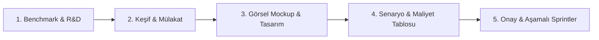

# 🚀 Antigravity Skills

Bu depo, **Google Antigravity** yapay zeka asistanını profesyonel bir yazılım ekibi, sistem mimarı ve ürün yöneticisi gibi çalıştırmak için geliştirilmiş özel yetenekler (Skills) koleksiyonudur.

---

## 🏛️ Öne Çıkan Skill: `studio-architect`

**Studio Architect**, yapay zekanın doğrudan alelacele kod yazmasını engelleyen ve projeyi **Spec-Driven Development (Şartname Odaklı Geliştirme)** standardına bağlayan evrensel bir keşif ve mimari protokolüdür.

Web, Mobil (iOS/Android), Masaüstü (Windows/macOS/Linux) ve Oyun (2D/3D) projelerinin tamamında uygulanabilir.



---

### 🌟 5 Aşamalı Protokol Nasıl Çalışır?

#### 1. 🔍 Pazar & Emsal Araştırması (Benchmark)
* Kullanıcı bir fikir veya referans verdiğinde (örn: *"Super Mombo Quest klonu"*, *"Masaüstü fatura programı"*), pazardaki en iyi 2-3 aktör incelenir.
* Rakiplerin güçlü/zayıf yönleri çıkarılır ve projeye fark yaratacak o **"Özel Dokunuş" (Unique Twist)** belirlenir.

#### 2. 💬 İnteraktif Mülakat (Discovery Dialogue)
* Kullanıcı tek seferde onlarca soruyla boğulmaz; platform, kullanıcı kitlesi ve temel hedefler adım adım sohbetle netleştirilir.
* Çoktan seçmeli kararlar için interaktif seçim panelleri kullanılır.

#### 3. 🎨 Görsel Tasarım & Mockup (Koddan Önce Tasarım!)
* Tek bir satır üretim kodu yazmadan önce arayüzün (UI/UX) son halinin nasıl görüneceği ekrana yansıtılır.
* Web/Masaüstü için dashboard şemaları ve renk paletleri; oyunlar için HUD (can, kombo, skor) ve kontrol şeması çizilir.

#### 4. 💰 Uçtan Uca Senaryo & Maliyet Analizi
* **Aşırı Detaylı Senaryo:** Kullanıcının uygulamayı açtığı ilk andan işlem bitimine, internet kopması gibi hata senaryolarına kadar tüm akış dökülür.
* **Maliyet Tablosu:** Mağaza lisansları (Apple \$99, Google Play \$25, Steam \$100), sunucu/veritabanı maliyetleri ve ücretsiz alternatifler (Supabase, Vercel free-tier) listelenir.

#### 5. 📋 Onay ve Sprint Planı
* Tüm bu süreç tek bir **GDD (Oyun Tasarım Belgesi)** veya **PRD (Ürün Şartnamesi)** haline getirilir.
* Kullanıcı *"Onaylıyorum, başla"* diyene kadar üretim kodu yazılmaz; onay gelince Sprint 0 ve MVP adımları başlatılır.

---

## 🛠️ Kurulum (Installation)

Antigravity'de bu skill'i bilgisayarında genel (global) olarak aktif etmek için:

```bash
# Global skills klasörüne kopyalayın
cp -r skills/studio-architect ~/.gemini/config/skills/
```

Veya belirli bir projede kullanmak için projenin kök dizinindeki `.agents/skills/` klasörüne ekleyin.

---

## 💡 Nasıl Kullanılır?

Skill kurulduktan sonra Antigravity'ye herhangi bir yeni fikirle gelmeniz yeterlidir:

```text
"Sana bir web uygulaması fikrim var: Notion benzeri ama sadece oyun geliştiricilere özel bir not alma aracı."
```
veya
```text
"Super Mombo Quest'in akıcı zıplama ve kombo mekaniğini barındıran bir platform oyunu yapmak istiyorum."
```

Antigravity otomatik olarak **Studio Architect** protokolünü başlatacak ve sırayla araştırma, tasarım, senaryo ve maliyet adımlarını sunacaktır.

---

## 📄 Lisans
MIT License. Dilediğiniz gibi kullanabilir, özelleştirebilir ve projelerinize entegre edebilirsiniz.
